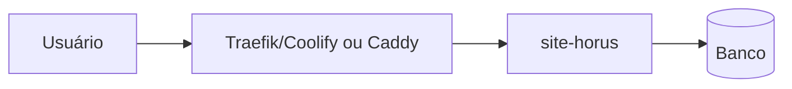

# Arquitetura · site-horus

> Gerado em 15/10/2026 a partir da auditoria de segurança (AUDITORIA.md). [V] = verificado, [NV] = não verificado. Nenhum segredo neste arquivo. Revisar antes do merge.

## Componentes
- Stack: HTML estático (`formulario.html`) em nginx
- UI: sem componentes

## Onde roda
horuscnt.com.br (Coolify site-horus, deploy de Venomwapp/site-horus master)

## Fluxos críticos
- Endpoints públicos: formulário de lead

## Limites conhecidos
- Sem Cloudflare (origem exposta). Sem health check na maioria dos apps do Coolify.
- Repo de deploy pode divergir do repo da org (ver seção 2.3 da auditoria).
